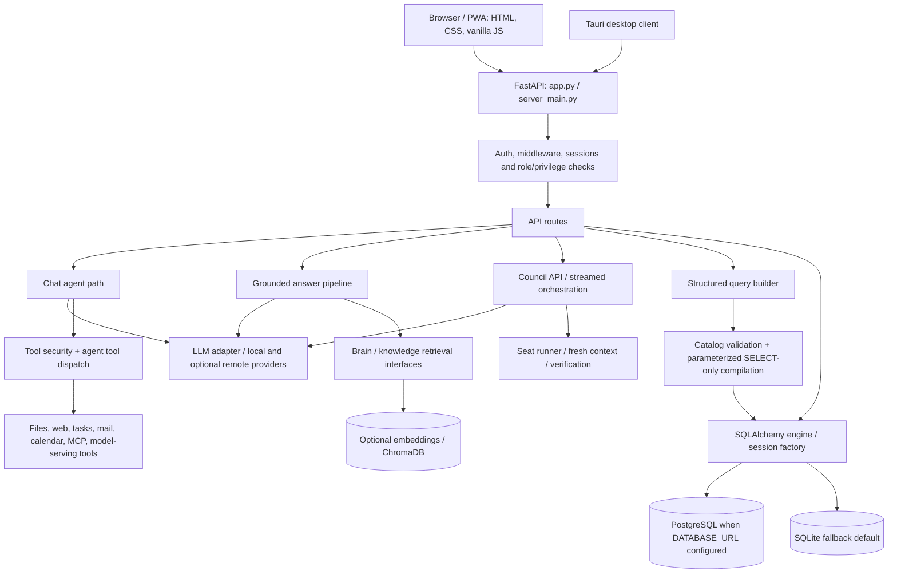
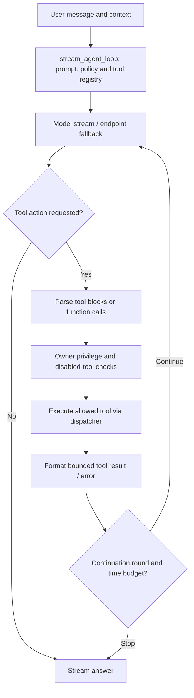
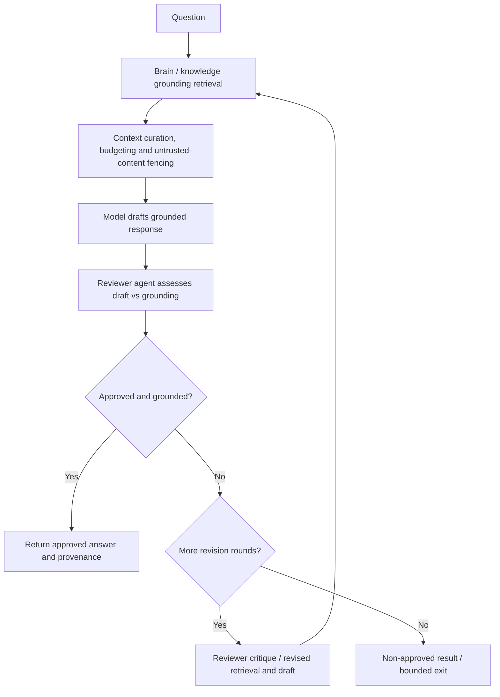
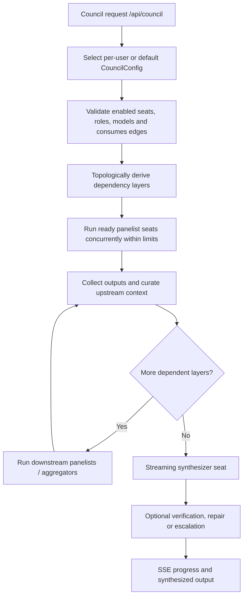
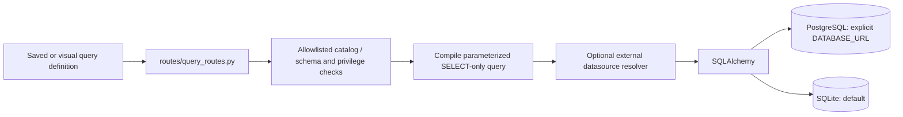

# Prisma — Public architecture and execution topology

> **PUBLIC RELEASE / SANITIZED TECHNICAL MAP.** This documents verified source-level components, not private infrastructure. Private brain corpora, user memories, customer-specific specialist configurations, secrets, model weights, machine identifiers and internal planning are excluded. The functional source interfaces remain part of the proposed release.

## Application and database topology

**Important:** These are separate route-specific processing paths, not evidence of a single universal intent router. PostgreSQL is explicitly supported via the SQLAlchemy `DATABASE_URL` connection path in `core/database.py`; SQLite is the fallback. Database-specific migration and feature parity require separate integration testing. Do not describe Prisma as a React, Express, or PostgreSQL-only application.

## Agentic loop: tool execution and feedback

Implementation: `src/agent_loop.py`, `src/agent_tools.py`, `src/tool_security.py`, `src/llm_core.py`. The tool surface includes files, documents, search, Python/shell, MCP, notes, tasks, email/calendar and model management. Privileged shell execution is **not fully sandboxed**; see `THREAT_MODEL.md`.

## Grounded answer and reviewer revision loop

Implementation: `src/answer_pipeline.py`, `src/context_curation.py`, `src/provenance.py`, `src/prompt_security.py`, `src/verified_gate.py`. Public source can describe the mechanism without releasing private brain knowledge or training data.

## Council: DAG-based parallel specialists and synthesis

Implementation: `routes/council_routes.py`, `src/council/orchestrator.py`, `src/council/schemas.py`, `src/council/seat_runner.py`, `src/council/fresh_context.py`. Seats may be panelists, aggregators or synthesizers; `consumes` defines dependencies. Independent seats in one layer execute concurrently, under timeouts and concurrency limits. Council configuration supports reasoning effort, fresh-context handling, optional code verification and escalation. The above is a conceptual control flow, not a claim that every configuration instantiates every optional stage.

## Structured query builder: separate from agent delegation

Implementation: `routes/query_routes.py`, `src/query_catalog.py`, `src/query_compiler.py`, `src/query_external.py` and `core/database.py`. The visual query builder is a distinct subsystem from agentic model selection and tool routing.

## Capability inventory

| Domain | Functional components |
| --- | --- |
| Clients | Browser/PWA with HTML/CSS/vanilla JavaScript, desktop client with Tauri |
| Core | FastAPI, API routes, SQLAlchemy, middleware, authentication, sessions |
| Reasoning | Chat/agent loop, grounded answer pipeline, multi-agent Council DAG |
| Agent actions | Tool schema parsing, dispatch, permission checks, retries and tool-result feedback |
| Knowledge | Memory and brain interfaces, retrieval, curation, provenance, optional vector embeddings |
| Data | SQLite default, configurable PostgreSQL via `DATABASE_URL`, structured query builder |
| Integrations | Optional Ollama/llama.cpp/vLLM, other model APIs, MCP, search, mail, calendar, notification and document services |
| Security | Privilege gating, untrusted-context defense, URL restrictions, authenticated private deployment |

## Publication boundary and limitations

The public topology intentionally omits credential values, private brain corpora, conversation histories, private specialist configs, deployment addresses, internal planning, and customer-specific datasets. Omitting private **data** must not be misrepresented as removing all functional brain **code**. Do not claim that an image or topology alone can reproduce private models or datasets.

This is a source-verified component diagram. It is **not** proof that PostgreSQL migrations, every deployment variant, or the complete public export has passed independent end-to-end tests. Review `SECURITY.md`, `THREAT_MODEL.md`, `PUBLIC-RELEASE.md` and current CI before publishing.
